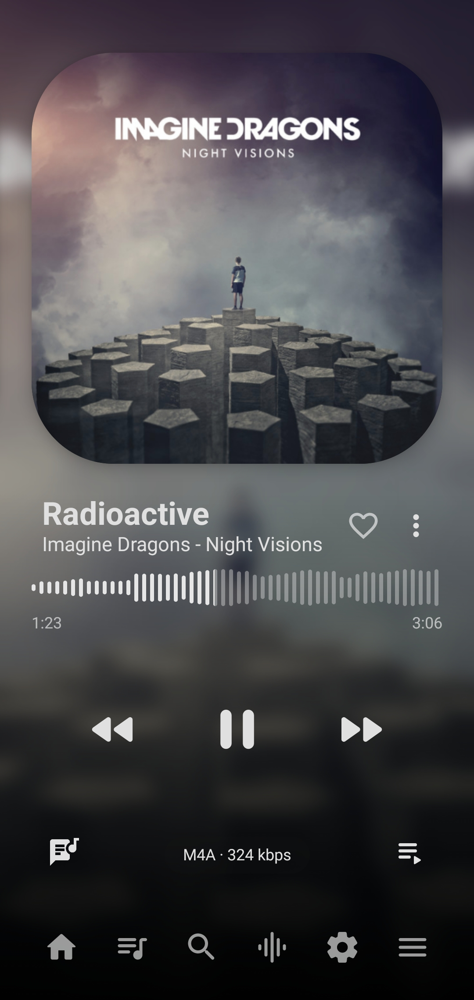
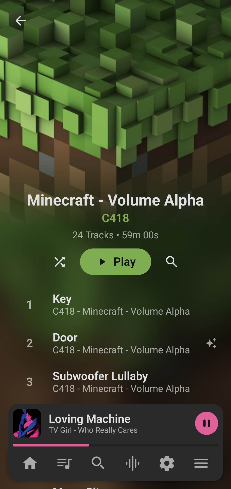
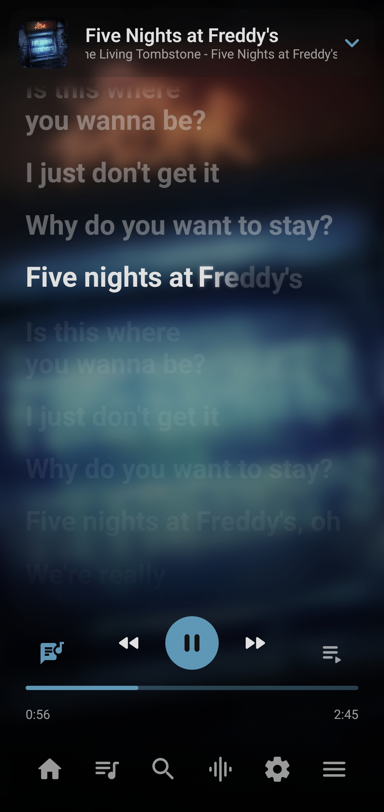
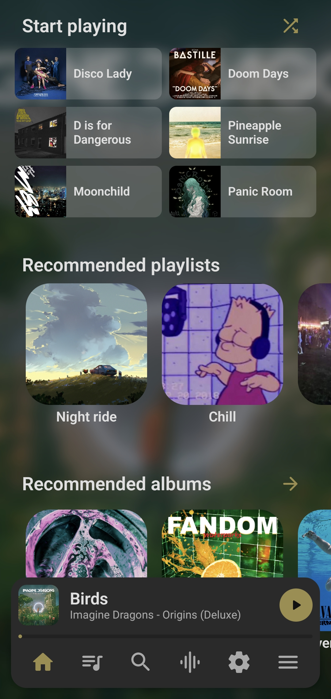
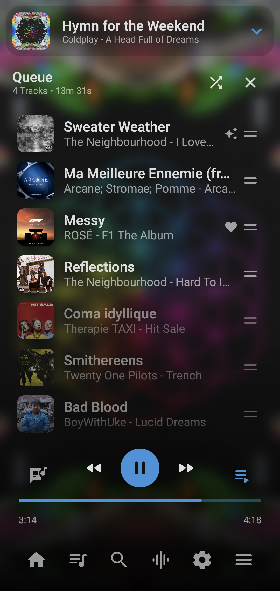
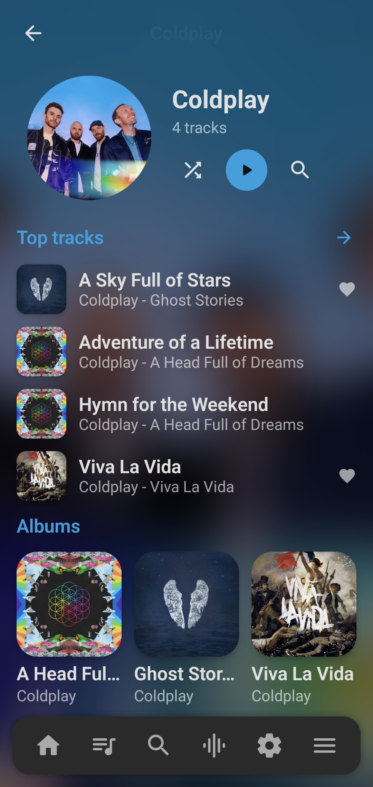

  

  <h1>FoamPlayer</h1>

  

    Description
  

  

  <a href="#-about"><b>About</b></a> •
  <a href="#-key-features"><b>Features</b></a> •
  <a href="#-showcase"><b>Showcase</b></a> •
  <a href="#architecture"><b>Architecture</b></a> •
  <a href="#contributing"><b>Contributing</b></a> •
  <a href="#credits"><b>Credits</b></a> •
  <a href="#legal-mentions"><b>Legal</b></a>
  

---

## 🌟 About
FoamPlayer is an independent music player for your local library.

Though for audiophiles, FoamPlayer supports Hi-Res bit perfect playback and is highly customizable.

The project is inspired from many other players, like Poweramp and rely on the open source community 
for some features (see more).

---

## ✨ Key Features
### Playback
* Bit-perfect playback tailored for supported devices.
* Independent audio settings for each output device.
* Playback fidelity score with a clear audio pipeline breakdown.
* Audio cross-fading at track ends.

### Lyrics
* Supports word-synced, line-synced, and plain lyrics.
* Loads lyrics embedded in your audio files or from external local files.
* Fetches missing lyrics from online providers.
* Built-in manager to search and save lyrics locally.
* Search for tracks by typing song lyrics.

### Integrations
* Animated video canvas support.
* Artist images fetched from Spotify.
* Discord Rich Presence status.

### Equalizer
*Currently in development.*

---

## 📸 Showcase
 

    
    
    
     
    
    
    
 

---

## Architecture

FoamPlayer is an Android app written in Kotlin, split into a main `:app` module and small library modules that isolate every online integration (lyrics, canvas, Spotify, Discord).

- **UI / Design** — Jetpack Compose.
- **Audio engine** — Media3/ExoPlayer + custom DSP chain, bit-perfect.
- **Data & Storage** — Room + DataStore.
- **Network** — Ktor (lyrics, canvas, Spotify, Discord).

More details in [docs/architecture.md](docs/architecture.md).

---

## Contributing
Feel free to contribute to the project, either if it's developing new features, fixing bug or making new translations.

---

## Credits
FoamPlayer is built thanks to multiple existing open source projects:
* **[ArchiveTune](https://github.com/rukamori/ArchiveTune)** : for the lyrics and canvas providers.
* **[Accompanist lyrics](https://github.com/6xingyv/accompanist-lyrics-core)** : for the lyrics display engine.

---

## License & Legal mentions
FoamPlayer is free software licensed under the **GNU General Public License v3.0 (GPLv3)**. See [LICENSE](LICENSE) for details.